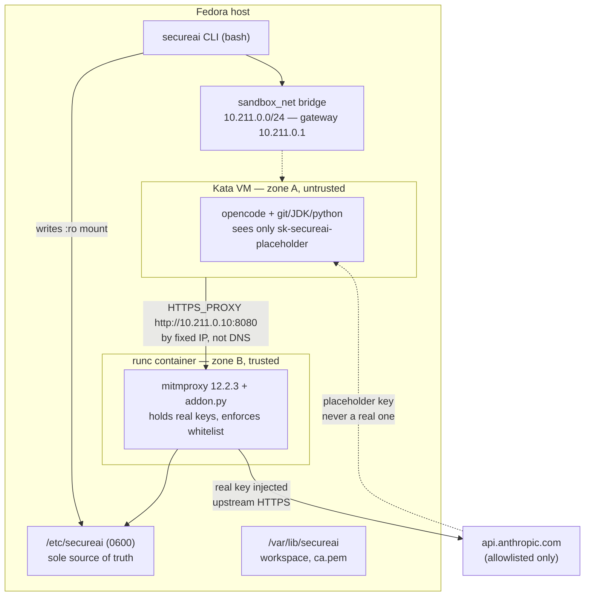

# Architecture Spine — SecureAI

## Design Paradigm

**Sealed egress.** Two zones split by a trust boundary; the only path across it is a single
mediating process that holds what neither zone may hold.

```
┌─ TRUST BOUNDARY: the agent may hold a name, never a secret ──────────┐
│                                                                       │
│  Zone A — UNTRUSTED (Kata VM)          Zone B — TRUSTED (runc)       │
│  ─────────────────────────────         ──────────────────────────     │
│  opencode + toolchain                  mitmproxy addon                │
│  sees: sk-secureai-placeholder         sees: the real API keys        │
│  egress: only to 10.211.0.10:8080      egress: anywhere allowlisted   │
│                                                                       │
│  Keys flow ONE way: Zone A → B (request) · B → upstream (real key)   │
│  Keys never flow B → A.                                                │
└───────────────────────────────────────────────────────────────────────┘
```

Mapping to namespaces: the two zones are two Docker services, and **the boundary is the
network interface between them** — not a code-level check. Every invariant below is
ultimately a statement about that boundary.

| Layer | Namespace | Owner |
| --- | --- | --- |
| Mediator | `proxy/` | addon's policy + injection only |
| Constrained agent | `opencode/` | guest, never reads key material |
| Control | `secureai` (bash), `install-fedora.sh` | host lifecycle |
| Secret state | `/etc/secureai` (0600) | proxy reads via `:ro` mount |

## Invariants & Rules

### AD-1 — The proxy is the sole enforcement point; the guest is not trusted to comply

- **Binds:** F3, F4, NFR-Security
- **Prevents:** Two units independently deciding "where do we enforce the whitelist?" — one
  gating in the addon, one gating in the guest — yielding a stack that is neither enforced nor
  debuggable.
- **Rule:** All whitelist enforcement lives in the mitmproxy addon. The guest receives no
  policy and performs no filtering of its own. `HTTPS_PROXY` is set because the runtime
  honors it, **not** because it is a security control.
- **Accepted risk:** enforcement is cooperative. Bun honors `HTTPS_PROXY`, so opencode routes
  through the proxy; an agent with a shell and `curl` can reach the internet directly and Kata
  installs no host-side egress filter. No network-level backstop is in scope for this MVP.
  Revisit if the threat model changes from "trusted developer, untrusted workload" to
  "adversarial agent."

### AD-2 — Enforcement acts on the HTTP layer; `tls_clienthello` observes only

- **Binds:** F3, F4
- **Prevents:** An addon written from pre-2023 tutorials calling `data.context.kill()`, which no
  longer exists — and a blocked host failing as a TCP reset instead of a readable 403.
- **Rule:** `tls_clienthello` reads SNI for policy and logging and takes **no action**.
  Enforcement happens in `requestheaders` via `Flow.kill()` or
  `http.Response.make(403)`. Only `Flow.kill()` exists; `Context.kill()` and
  `Connection.kill()` were removed.
- **Corollary:** with `Flow.kill()` only, a pre-handshake TCP drop has no supported API. Do
  not design one.

```python
class Policy:
    def tls_clienthello(self, data):          # observe only — no action
        self.sni = data.client_hello.sni

    def requestheaders(self, flow):           # the only place policy acts
        if not self.allowed(flow.request.host, flow.request.scheme):
            flow.response = http.Response.make(403, b"blocked by secureai")

    def responseheaders(self, flow):          # SSE must stream or it never emits
        if flow.response.headers.get("content-type", "").startswith("text/event-stream"):
            flow.response.stream = True
```

### AD-3 — Never stream a response whose request headers you rewrite

- **Binds:** F3, Success Criteria
- **Prevents:** The product's core demo failing as a silent hang. mitmproxy buffers the entire
  SSE body until the response closes, so no token is ever emitted and opencode's 300s
  `chunkTimeout` aborts the request — surfacing as an OpenCode error, not a proxy error.
- **Rule:** `.stream = True` is set in `responseheaders` **before any body is read**. Key
  injection rewrites only *request* headers, which is compatible with streaming. If a response
  body ever needs rewriting, that response must not be streamed.

### AD-4 — CA trust extends the system store; it never replaces it

- **Binds:** F3, NFR-Security
- **Prevents:** `SSL_CERT_FILE` pointing at the mitm CA alone. OpenSSL **replaces** the default
  bundle (hard `if`/`else` on the env var in `crypto/x509/by_file.c`), so the store would hold
  only the mitm CA and every public HTTPS call — `git clone`, `curl https://github.com` —
  fails verification. The stack would appear to work while being unable to reach anything.
- **Rule:** The mitm CA is installed into the guest **system** trust store
  (`/usr/local/share/ca-certificates/` + `update-ca-certificates`) at image build. One store
  satisfies Bun, Node, curl, and git. `SSL_CERT_FILE`, `REQUESTS_CA_BUNDLE`, and
  `GIT_SSL_CAINFO` are either unset or point at a **concatenated** bundle. Only the **public**
  cert is exposed to the guest; the private key never leaves the proxy.

### AD-5 — The proxy is addressed by fixed IP, never by name

- **Binds:** F2, F4, F12
- **Prevents:** Two units independently choosing how the guest finds the proxy. Docker forces
  `nameserver 127.0.0.11`, which **does not exist inside the Kata VM** (the VM sits behind a
  tap device, not in the container netns) — kata-containers#6688, open since 2023. Service-name
  resolution fails silently as a generic "connection refused".
- **Rule:** The guest env carries a literal `HTTPS_PROXY=http://10.211.0.10:8080`. **The bridge
  subnet and the proxy address are one owned value** — declared once, in one place, and
  consumed by the CLI and the compose file. It is never written twice. `NO_PROXY` is always
  `localhost,127.0.0.1,::1`; without it the TUI's loopback server call routes back through the
  proxy and deadlocks.

### AD-6 — One owner for host-level runtime wiring

- **Binds:** F1, F2
- **Prevents:** The installer and the CLI each writing `daemon.json` — one using the Go
  runtime, one runtime-rs, one omitting the Docker 29 workaround.
- **Rule:** `install-fedora.sh` is the **only** writer of `/etc/docker/daemon.json`. It
  registers Kata as `"runtimeType": "<path>/containerd-shim-kata-v2"` plus `ConfigPath`, and
  sets `"features": {"time-namespaces": false}` (Docker ≥29.5 breaks Kata with `invalid
  namespace type`, kata#13080). `kata-qemu` is a **name**, not an executable. The CLI only
  passes `--runtime kata`; it never edits daemon config.

### AD-7 — Multi-consumer host paths use `:z`; private `:Z` is single-consumer only

- **Binds:** F9
- **Prevents:** The classic `:Z` footgun — a private MCS label applied by one container, then
  mounted by a second, which relabels again and breaks the first.
- **Rule:** A host path mounted by **more than one** service (`workspace`, `keys.yaml`,
  `whitelist.yaml`, `ca.pem`) uses shared label `:z`, or is mounted read-only **without** a
  private label. `:Z` is reserved for paths with exactly one consumer. Inside the Kata guest no
  SELinux labelling works (kata#11685) — never pass a `context=` mount option.

### AD-8 — The guest makes no outbound calls that widen its own surface

- **Binds:** F4, F6, NFR-Security
- **Prevents:** Dependencies discovered only at runtime, each one an unvetted egress hole and
  a silent addition to the allowlist.
- **Rule:** Guest config sets `autoupdate: false`, `share: "disabled"`, `shell: "/bin/sh"`. The
  model catalog is **vendored**: `OPENCODE_MODELS_PATH` points at a pre-seeded JSON and
  `OPENCODE_DISABLE_MODELS_FETCH=1`, so `models.opencode.ai` leaves the allowlist entirely.
  `XDG_CONFIG_HOME` / `XDG_DATA_HOME` / `XDG_CACHE_HOME` / `XDG_STATE_HOME` are set explicitly
  so mount points do not depend on `$HOME` resolution. Provider SDKs that opencode installs at
  runtime into `~/.cache/opencode/bin` must be pre-seeded at build or explicitly allowlisted.

### AD-9 — The base image is ours; the runtime inside it is not

- **Binds:** F11
- **Prevents:** Assuming the opencode runtime is Node. It is not.
- **Rule:** `opencode-ai@1.18.34` installs a **Bun-compiled native binary**
  (`opencode-linux-x64`, 185 MB ELF, Bun + JavaScriptCore, no V8) via a `postinstall.mjs` that
  hardlinks it over a 479-byte stub. The `node:22` base supplies git, JDK, python, and the
  toolchain — **not** the opencode runtime. Consequences: on bookworm use the glibc package,
  never `-musl`; `opencode --version` must succeed in the build layer or postinstall throws;
  `--ignore-scripts` yields the useless stub. `ghcr.io/sst/opencode` **no longer exists** — the
  image moved to `ghcr.io/anomalyco/opencode` (Alpine, root, no git — opencode hard-errors
  without git).

### AD-10 — Nothing is proven until the three checks pass

- **Binds:** F3, F4, all Success Criteria
- **Prevents:** A clean session launch being read as success. It proves nothing. A silently
  ignored `HTTPS_PROXY` produces a *working-looking* session that bypasses the whitelist until
  someone curls a blocked host. A rejected `NODE_EXTRA_CA_CERTS` produces a TLS error that
  reads as "the proxy is broken."
- **Rule:** A capability is unproven until all three hold: **(a)** the proxy log shows the API
  host, **(b)** the real key arrives upstream, **(c)** a non-allowlisted host **fails**. Gate (c)
  is the one that catches the bypass. `NODE_EXTRA_CA_CERTS` in particular is *unconfirmed* —
  Bun 1.3.6 reportedly ignored it (bun#17325) and opencode carries a family of unresolved
  reports (#3130, #4883, #3566, #923, #1694, #7073). It is **risk #1** and the first thing to
  smoke-test.

## Consistency Conventions

| Concern | Convention |
| --- | --- |
| Naming (entities, files, interfaces, events) | `secureai` CLI, `secureai_net` bridge, `kata-opencode-sandbox` image. Compose service names are singular nouns: `opencode`, `proxy`. Addon classes are noun-free and behavior-named. |
| Data & formats (ids, dates, error shapes, envelopes) | All config is YAML (`whitelist.yaml`, `settings.yaml`, `keys.yaml`). Whitelist entries are one host per line; `*.example.com` matches subdomains. Keys are `host: key` pairs, values always quoted. Blocked requests receive HTTP 403 with body `blocked by secureai`. |
| State & cross-cutting (mutation, errors, logging, config, auth) | Host config/state only under `/etc/secureai` (source of truth, root 0600) and `/var/lib/secureai` (runtime). **The CLI writes `/etc` and is the sole writer**; the proxy mounts read-only and never writes. Real keys never appear in the opencode image, compose file, guest env, or logs. Access logs are scrubbed. |
| Naming — key material | The placeholder is one constant, `sk-secureai-placeholder`, defined once in `settings.yaml` and referenced by the addon and the compose env. It is never duplicated as a literal. |
| Errors | The proxy fails **closed**: unknown host, unreadable config, or missing key ⇒ 403, never passthrough. |
| Logging | One log line per blocked flow: host, scheme, decision. No key material, ever. |

## Stack

SEED — verified current at authoring (2026-10-06); the code owns this once it exists.

| Name | Version |
| --- | --- |
| Fedora | 43 or 44 (41 and 42 are EOL) |
| Kata Containers | Fedora `kata-containers` 3.25.0 (F43) / 3.26.0 (F44); Go runtime deprecated upstream, runtime-rs default since Kata 4.0.0 |
| Docker Engine | ≤28.5.2, or ≥29.5.0 **with** `features.time-namespaces: false` |
| Docker Compose | v2 (`runtime:`, `depends_on: condition: service_healthy`) |
| mitmproxy | 12.2.3 |
| opencode-ai (npm) | 1.18.34 — Bun-compiled native binary, not a Node runtime |
| Bun (inside opencode) | ships with the binary; version unverified — `NODE_EXTRA_CA_CERTS` support uncertain |
| Node.js (base image, toolchain only) | ≥22.21.0 if any Node code ever needs proxy env vars |
| Base image | `node:22-bookworm-slim` (glibc) |
| mitmproxy base image | `python:3.14-slim-trixie` (Debian — official image is no longer Alpine) |

## Structural Seed



**Deployment & environments.** Single environment: a developer Fedora workstation with nested
virtualization. `install-fedora.sh` is the one-shot bootstrap (Kata, Docker, CLI, `/etc` +
`/var/lib` dirs, SELinux labels, mitm CA). The CLI is the sole interactive surface — the user
never invokes `docker` directly (F6, NFR-UX). **Host prerequisites the installer must assert,
not assume:** nested virt enabled; Fedora 43/44; and the Docker/Kata pair is not (Docker ≥29.5,
Kata <3.31) unless the `time-namespaces` workaround is written.

```text
secureai/
├── install-fedora.sh        # ONE writer of daemon.json (AD-6)
├── secureai                 # bash CLI → /usr/local/bin/secureai
├── docker-compose.yml       # declares the ONE bridge subnet + proxy IP (AD-5)
├── opencode/Dockerfile      # toolchain + vendored catalog + system CA (AD-4, AD-8)
└── proxy/
    ├── Dockerfile           # mitmproxy 12.2.3
    └── addon.py             # AD-2 + AD-3: the only enforcement point
```

## Capability → Architecture Map

| Capability / Area | Lives in | Governed by |
| --- | --- | --- |
| F1 One-click install | `install-fedora.sh` | AD-6, AD-7, Stack |
| F2 Kata isolation | compose `opencode` service | AD-6, AD-9 |
| F3 Key injection | `proxy/addon.py` | AD-1, AD-2, AD-3, AD-4, AD-10 |
| F4 Egress whitelist | `proxy/addon.py` | AD-1, AD-2, AD-10 |
| F5 CLI in PATH | `secureai` | Stack, conventions |
| F6 Interactive session | `secureai` | AD-5, AD-8 |
| F7 `whitelist add` | `secureai` → `/etc/secureai` | conventions (state) |
| F8 `keys set` | `secureai` → `/etc/secureai` 0600 | conventions (state) |
| F9 SELinux labels | all bind mounts | AD-7 |
| F10 Auto-cleanup (`--rm`) | `secureai`, compose | — |
| F11 Prebuilt image | `opencode/Dockerfile` | AD-9, AD-8 |
| F12 Proxy teardown | `secureai` | AD-5 |

## Open Questions

- **BLOCKING — `internal: true` may be a network backstop.** The compose sets
  `sandbox_net: internal: true` commented "no route to the internet". If that actually applies
  to the Kata VM's tap device, AD-1's accepted risk is void and this spine is stronger than it
  claims. If it doesn't, the comment is false comfort. **Unverified — resolve before trusting
  either reading.**
- **Plaintext `http://` egress.** `$HTTP_PROXY` covers scheme `http`, `$HTTPS_PROXY` only
  `https`. The addon must gate on **transport scheme as well as** SNI/Host, or plaintext is an
  unguarded path. Not yet designed.
- **Does the pinned Bun build honor `NODE_EXTRA_CA_CERTS`?** AD-10 risk #1. Unconfirmed.
- **Is DNS-level enforcement needed beyond SNI?** Inherited unanswered. Interacts with the
  `resolv.conf` question now moot under AD-5.

## Deferred

| Deferred | Why it can wait |
| --- | --- |
| Automated tests / CI | Explicitly out of MVP scope (PRD). |
| Upgrade & migration path | Explicitly out of MVP scope. |
| Multi-user key management | Explicitly out of MVP scope. |
| Performance tuning (Kata boot) | Explicitly accepted as slow (PRD). |
| Network-level egress backstop (host iptables) | Trade-off made in AD-1; revisit if the threat model changes from trusted-developer to adversarial-agent. |
| Pre-handshake TCP drop for blocked hosts | No supported API exists (`Context.kill()` removed); 403 at the HTTP layer is the available answer. |
| HTTP/2 correctness, WebSocket-through-MITM | Upstream to the MVP; the one bespoke path is opencode's OpenAI Realtime WebSocket. |
| Multi-platform support | Fedora only (PRD non-goal). |
| Upgrade to Kata runtime-rs | Go runtime still works on F43/F44; runtime-rs is the upstream default but the Fedora build's Docker usability is unverified. |