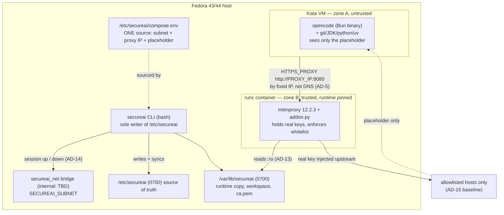

# Architecture Spine — SecureAI

> **Quality bar: showcase proof of concept, not production-hardened.** Decisions here favour
> *provable on one machine* over *correct in general*. Where hardening and demonstrability
> conflict, demonstrability wins — and the conflict is named rather than silently absorbed.

## Design Paradigm

**Sealed egress.** Two zones split by a trust boundary; the only path across it is a single
mediating process that holds what neither zone may hold.

```
┌─ TRUST BOUNDARY: the agent may hold a name, never a secret ──────────┐
│                                                                       │
│  Zone A — UNTRUSTED (Kata VM)          Zone B — TRUSTED (runc)       │
│  ─────────────────────────────         ──────────────────────────     │
│  opencode + toolchain                  mitmproxy addon                │
│  sees: the placeholder                 sees: the real API keys        │
│  egress: only to the proxy by IP       egress: anywhere allowlisted   │
│                                                                       │
│  Keys flow ONE way: A → B (request) · B → upstream (real key)        │
│  Keys never flow B → A.                                                │
└───────────────────────────────────────────────────────────────────────┘
```

| Layer | Namespace | Owner |
| --- | --- | --- |
| Mediator | `proxy/` | policy + injection, nothing else |
| Constrained agent | `opencode/` | guest; never reads key material |
| Control | `secureai` (bash), `install-fedora.sh` | host lifecycle and config |
| Secret state | `/etc/secureai` → `/var/lib/secureai` | CLI writes; proxy reads `:ro` |

**Falsifiable prediction:** any change that adds a *second* path from Zone A to the internet
violates this paradigm. If a proposal adds one, the paradigm is wrong and this spine must be
rewritten rather than amended.

## Invariants & Rules

### AD-1 — The proxy is the sole enforcement point; the guest is not trusted to comply

- **Binds:** F3, F4, NFR-Security
- **Prevents:** Two units independently answering "where is the whitelist enforced?" — one in
  the addon, one in the guest — producing a stack that is neither enforced nor debuggable.
- **Rule:** All whitelist enforcement lives in `proxy/addon.py`. The guest receives no policy
  and filters nothing. `HTTPS_PROXY` is set because the runtime honors it, **not** because it
  is a control.
- **Accepted risk (provisional):** enforcement is *cooperative*. Enforcement happens at
  `requestheaders` — i.e. **after** CONNECT and the TLS handshake to the blocked host, so a
  blocked host observes the handshake. A guest process that ignores `http_proxy`/
  `https_proxy` bypasses the whitelist entirely; Kata installs no host-side egress filter and
  no iptables backstop is in scope for this MVP. Provisional pending the `internal: true`
  question in Open Questions.
- **Consequence for the success criteria:** `curl https://google.com` fails **because curl
  honors the proxy env vars**, not because the network blocks it. That test proves the proxy
  enforces; it does **not** prove the guest cannot route around it.

### AD-2 — Enforcement acts on the HTTP layer; `tls_clienthello` observes only

- **Binds:** F3, F4
- **Prevents:** An addon written from pre-2023 tutorials calling `data.context.kill()`, which no
  longer exists — and a blocked host failing as an opaque TCP reset instead of a readable 403.
- **Rule:** `tls_clienthello` reads SNI for policy and logging and takes **no action**.
  Enforcement lives in `requestheaders` via `Flow.kill()` or `http.Response.make(403)`.
  `tls_clienthello` receives a `Context`, not a `Flow`, so `Flow.kill()` is not callable there;
  `Flow.kill_connection` also needs a `Flow`. Treat 403-at-`requestheaders` as the available
  answer, and revisit only if `next_layer` / `tls_start_client` are investigated.
- **Shape:** one addon class in `proxy/addon.py` holding all three hooks. State is per-flow or
  per-connection (`flow.metadata`); addon instance attributes are process-global and must never
  carry request state.

```python
class SecureAIAddon(mitmproxy.addons.Addon):
    def tls_clienthello(self, data):      # observe only — no action
        data.context.metadata["sni"] = data.client_hello.sni

    def requestheaders(self, flow):       # the only place policy acts
        if not allowed(flow.request.host, flow.request.scheme):
            flow.response = http.Response.make(403, b"blocked by secureai")

    def responseheaders(self, flow):      # SSE must stream or it never emits
        if flow.response.headers.get("content-type", "").startswith("text/event-stream"):
            flow.response.stream = True
```

### AD-3 — Never stream a response whose request headers you rewrite

- **Binds:** F3, Success Criteria
- **Prevents:** The core demo failing as a silent hang. mitmproxy buffers the entire SSE body
  until the response closes, so no token is emitted and opencode's request timeout aborts it —
  surfacing as an OpenCode error, not a proxy error.
- **Rule:** `.stream = True` is set in `responseheaders` **before any body is read**. Key
  injection rewrites only *request* headers, which is compatible with streaming. A response
  whose body must be rewritten is never streamed.

### AD-4 — CA trust extends the store; it never replaces it — and Node/Bun are not assumed

- **Binds:** F3, NFR-Security
- **Prevents:** `SSL_CERT_FILE` pointing at the mitm CA alone. On Debian-based images
  `SSL_CERT_FILE` replaces the default PEM file; whether the hashed `SSL_CERT_DIR` still
  applies is build-dependent and must not be relied on. The stack would appear to work while
  being unable to reach anything — every `git clone` and `curl https://github.com` would fail
  verification.
- **Rule:** The mitm CA is installed into the guest **system** trust store
  (`/usr/local/share/ca-certificates/` + `update-ca-certificates`) at image build. That store
  satisfies **curl and git** only. **Node and Bun are not assumed to read it** — Node ships a
  bundled Mozilla set, Bun ships its own, and `NODE_EXTRA_CA_CERTS` support in the pinned Bun
  build is *unconfirmed*. `SSL_CERT_FILE` / `REQUESTS_CA_BUNDLE` / `GIT_SSL_CAINFO` are either
  unset or point at a **concatenated** bundle. Only the public cert is exposed to the guest; the
  private key never leaves the proxy.

### AD-5 — The proxy is addressed by fixed IP; the guest owns its own resolver

- **Binds:** F2, F4, F6, F12
- **Prevents:** Two units independently choosing how the guest finds the proxy. Docker forces
  `nameserver 127.0.0.11`, which **does not exist inside the Kata VM** (the VM sits behind a tap
  device, not in the container netns) — kata-containers#6688, open since 2023. Resolution fails
  as `EAI_NONAME` / ENOTFOUND, which reads as "could not resolve host", not as a proxy error.
- **Rule:** The guest env carries a literal `HTTPS_PROXY=http://10.211.0.10:8080`. The bridge
  subnet and proxy address are written **once**, in `compose.env` (AD-11), and consumed as
  `${...}` everywhere. Separately, the guest must not use Docker's embedded resolver:
  `docker-compose.yml` sets `dns:` on the `opencode` service to the bridge gateway, and
  `opencode/Dockerfile` does **not** bake `/etc/resolv.conf`. Upstream name resolution is
  guest-local and carries no enforcement meaning — SNI is the enforcement signal.
- **Corollary:** `NO_PROXY=localhost,127.0.0.1,::1` is always set. Without it the TUI's loopback
  server call routes back through the proxy and deadlocks.

### AD-6 — One owner for host runtime wiring; the proxy is pinned to runc

- **Binds:** F1, F2
- **Prevents:** The installer and the CLI both writing `daemon.json`, in different dialects.
  Worse: an installer that sets `"default-runtime": "kata"` would move the **key-holding proxy
  into the Kata VM** — every other AD would still pass, and the trust zone would be silently
  destroyed.
- **Rule:** `install-fedora.sh` is the **only** writer of `/etc/docker/daemon.json`. It registers
  one runtime named `kata` and leaves `default-runtime` untouched. The proxy service declares
  `runtime: runc` **explicitly**; the installer asserts it. Exactly one artifact declares the
  opencode runtime — `docker-compose.yml` (`runtime: kata` on `opencode`) — and the CLI passes
  **no** `--runtime` flag, since a flag silently overrides the compose field with no error.
- **Version matrix (one row, not a disjunction):** `features.time-namespaces: false` is written
  **only when Docker ≥ 29.5**, which otherwise breaks Kata with `invalid namespace type`
  (kata#13080, reproduced on F44 with Docker 29.5.1 + Kata 3.31.0). Below 29.5 the flag is not
  written. `kata-qemu` is a **name**, not an executable; Docker points at
  `containerd-shim-kata-v2` with `ConfigPath` under the runtime's `options`. The Go runtime is
  used because the Fedora package ships it; upstream defaults to runtime-rs since 4.0.0.

### AD-7 — Multi-consumer host paths use `:z`; `:Z` is single-consumer only

- **Binds:** F1, F9, NFR-SELinux
- **Prevents:** The `:Z` footgun — a private MCS label applied by one container, then mounted by
  a second, which relabels again and breaks the first. Also prevents a "read-only, no label"
  escape that is simply permission-denied on an enforcing host (`/etc/secureai` is `etc_t`,
  unreadable from an MCS-labeled domain).
- **Rule:** "Consumer" means a **compose service**, never the host. On an enforcing host every
  bind mount into any container carries `:Z` (one consumer) or `:z` (two or more); an unlabelled
  read is not permitted. `install-fedora.sh` relabels `/etc/secureai` and `/var/lib/secureai`
  with `semanage fcontext -a -t container_file_t` + `restorecon`, asserts the result with `ls -Z`,
  and warns-but-continues when SELinux is permissive or disabled. No `context=` mount option is
  ever passed — guest-side relabelling does not work (kata#11685).
- **Amends F9:** the PRD's "all bind mounts use `:Z`" is refined to `:Z`/`:z` by consumer count.
- **Open:** whether Kata + Docker needs a policy module for the VMM path is unverified; if
  host denials appear, `ausearch -m avc -ts recent` is the diagnostic.

### AD-8 — The guest makes no outbound calls that widen its own surface

- **Binds:** F4, F6, F11
- **Prevents:** Dependencies discovered only at runtime — each an unvetted egress hole and a
  silent addition to the allowlist.
- **Rule:** Guest config sets `autoupdate: false`, `share: "disabled"`, `shell: "/bin/sh"`. The
  model catalog is **vendored**: `OPENCODE_MODELS_PATH` points at a pre-seeded JSON and
  `OPENCODE_DISABLE_MODELS_FETCH=1`, so `models.opencode.ai` leaves the allowlist entirely.
  `XDG_CONFIG_HOME=/home/node/.config`, `XDG_DATA_HOME=/home/node/.local/share`,
  `XDG_CACHE_HOME=/home/node/.cache`, `XDG_STATE_HOME=/home/node/.local/state` are set
  explicitly, and those paths are the persisted volumes. Provider SDKs opencode installs at
  runtime into `~/.cache/opencode/bin` **must be pre-seeded at build**; a runtime-discovered
  dependency is a build failure, not an allowlist entry.

### AD-9 — The base image is ours; the runtime inside it is not

- **Binds:** F11
- **Prevents:** Assuming the opencode runtime is Node. It is not — and assuming the base
  supplies the toolchain. It does not.
- **Rule:** `opencode-ai@1.18.34` installs a **Bun-compiled native binary**
  (`opencode-linux-x64`, ~185 MB ELF, Bun + JavaScriptCore, no V8) via a `postinstall.mjs` that
  hardlinks it over a 479-byte stub. On bookworm use the **glibc** package, never `-musl`;
  `opencode --version` must succeed in the build layer or postinstall throws; `--ignore-scripts`
  yields the useless stub. The `node` base supplies **nothing** the runtime needs.
- **Toolchain is an explicit install.** No official `node:*` image ships git, JDK, or python —
  `-slim` least of all — and opencode hard-errors without git. `opencode/Dockerfile` explicitly
  installs `git python3 python3-pip default-jdk-headless ripgrep jq curl openssh-client` plus
  `uv` (from `ghcr.io/astral-sh/uv`), under a non-root `node` user (UID 1000), with
  `UV_LINK_MODE=copy` and `UV_NATIVE_TLS=1`.
- **Upstream reference:** `ghcr.io/sst/opencode` **no longer exists** — the image moved to
  `ghcr.io/anomalyco/opencode` (Alpine, root, no git).

### AD-10 — Nothing is proven until four gates pass

- **Binds:** F3, F4, F11, all Success Criteria
- **Prevents:** A clean session launch being read as success. It proves nothing. A silently
  ignored `HTTPS_PROXY` produces a *working-looking* session that bypasses the whitelist. A
  rejected `NODE_EXTRA_CA_CERTS` produces a TLS error that reads as "the proxy is broken".
- **Rule:** `secureai verify` (CLI-owned) must show all four:
  **(a)** the proxy log shows the API host; **(b)** injection occurred — logged as
  `authz=injected provider=<host> fp=<4-char sha256 prefix>`, a **fingerprint, never key
  material**; **(c)** a non-allowlisted host fails *through the proxy* (scoped per AD-1);
  **(d)** an HTTPS call **from the Bun/Node runtime inside the guest** through the proxy
  succeeds — curl succeeding proves only curl.
- **Risk #1:** gate (d) is unconfirmed. Bun 1.3.6 reportedly ignored `NODE_EXTRA_CA_CERTS`
  (bun#17325) and opencode carries unresolved reports (#3130, #4883, #3566, #923, #1694,
  #7073). It is the first thing to smoke-test, before any other work.

### AD-11 — Constants that cross the compose boundary live in exactly one file

- **Binds:** F5, F6, F7, F8
- **Prevents:** The subnet, proxy address, and placeholder key being written literally in the
  compose file, the Dockerfile, the addon, and scripts — four copies that drift silently.
- **Rule:** `/etc/secureai/compose.env` (`0640`, root) holds `SECUREAI_SUBNET`,
  `SECUREAI_GATEWAY`, `SECUREAI_PROXY_IP`, `SECUREAI_PROXY_PORT`, `SECUREAI_PLACEHOLDER_KEY`.
  `docker-compose.yml` references them as `${...}` **only**; `secureai` sources the same file
  before invoking `docker compose`. These values may not be written literally anywhere else.
  `install-fedora.sh` may create the file but not populate it; the CLI is its sole writer.

### AD-12 — The CA has one producer and a defined build order

- **Binds:** F1, F3, F11
- **Prevents:** A circular dependency — the CA does not exist until mitmproxy has run, but
  AD-4 requires it at image build — plus the CA having three legal homes (baked image,
  `/var/lib` bind mount, build secret) and no owner.
- **Rule:** `secureai ca export` (CLI-owned) runs a one-shot `mitmproxy` container with
  `--set confdir=/var/lib/secureai/ca` and copies `mitmproxy-ca-cert.pem` to
  `/var/lib/secureai/ca.pem` (`0644`). `opencode/Dockerfile` `COPY`s it into
  `/usr/local/share/ca-certificates/`. **Build order: `secureai ca export` before
  `docker build`.** The CA is never bind-mounted into a running container.

### AD-13 — Key state has one writer and one read path

- **Binds:** F7, F8, NFR-Security
- **Prevents:** Two units both "owning" the keys file, and a running proxy serving a stale
  policy after `whitelist add`.
- **Rule:** `/etc/secureai` (`0700`) is the **sole source of truth**; the CLI is its only
  writer and syncs `keys.yaml` / `whitelist.yaml` to `/var/lib/secureai` (`0700`), which the
  proxy mounts `:ro`. Config files are `0640` root:root. The proxy **never writes** config.
  The addon **re-reads config per flow** (mtime-bounded cache, default 5s) and fails closed on
  unreadable or unparseable config — this is what makes F7's "no restart needed" true.
  `keys list` **always masks** values.

### AD-14 — Session lifecycle: the proxy dies with the agent

- **Binds:** F10, F12, F6
- **Prevents:** F12 having no mechanism, and orphaned containers after an exit.
- **Rule:** The CLI brings the pair up as a session and tears it down on exit — both services
  use `docker compose run --rm` semantics so the user lands **inside** opencode (`-it`), not
  via `docker exec` and not via `up`. The proxy is started first and the opencode container
  waits on `depends_on: proxy: condition: service_healthy`; the proxy service therefore carries
  a real healthcheck. A shell `trap` in the CLI tears the session down on INT/TERM, and both
  containers carry `--rm`. **No systemd unit auto-starts the proxy** — that would contradict
  F12's per-session self-containment.

## Consistency Conventions

| Concern | Convention |
| --- | --- |
| Naming | `secureai` CLI; `secureai_net` bridge; compose services are singular nouns (`opencode`, `proxy`); addon classes behavior-named (`SecureAIAddon`). |
| Constants | Anything crossing the compose boundary lives in `compose.env` and is referenced as `${...}` (AD-11). The placeholder is one constant, never a duplicated literal. |
| Data & formats | YAML config: `whitelist.yaml`, `settings.yaml`, `keys.yaml` (+ `keys.yaml.template` with empty values for onboarding). Whitelist is one host per line; `*.example.com` matches subdomains. Keys are `host: key`, values quoted, files `0640` root:root. Error shape: HTTP 403, body `blocked by secureai`. |
| State & mutation | See AD-13 (config) and AD-14 (lifecycle). The CLI writes; the proxy reads `:ro`. |
| Auth & secrets | Real keys never appear in the opencode image, compose file, guest env, `compose.env`, or logs. Logs carry a 4-char fingerprint only. `keys list` masks. |
| Errors | The proxy **fails closed**: unknown host, unreadable config, missing key ⇒ 403, never passthrough. |
| Logging | One line per blocked flow: host, scheme, decision. Scrubbed at source — mitmproxy runs with `--set flow_detail=0` and `-q`; the addon never logs header values. |
| CLI surface | `opencode`, `down`, `status`, `whitelist add\|list`, `keys set\|list`, `ca export`, `verify`. Bash throughout — no new language dependency (`yq` is not used). |

## Stack

SEED — verified current at authoring (2026-10-06); the code owns this once it exists. Because
the PRD rules out an upgrade path, a pin that ages out is a **known accepted cost**, not a
maintenance obligation.

| Name | Version | Verified against |
| --- | --- | --- |
| Fedora | 43 or 44 | 41 and 42 are EOL (2025-12-15 / 2026-05-27) |
| Kata Containers | `kata-containers` 3.25.0 (F43) / 3.26.0 (F44), Go runtime | packages.fedoraproject.org, Bodhi |
| Docker Engine | ≤28.5.2, **or** ≥29.5.0 with `features.time-namespaces: false` | kata#13080 |
| Docker Compose | v2 (`runtime:`, `run --rm`, `depends_on: service_healthy`) | — |
| mitmproxy | 12.2.3 | GitHub releases 2026-05-12 |
| mitmproxy base image | `mitmproxy/mitmproxy:12.2.3` — Debian-based (trixie), **not** Alpine | upstream Dockerfile on `main` |
| opencode-ai (npm) | 1.18.34 — Bun-compiled native binary, not a Node runtime | npm registry tarballs, ELF inspected |
| Bun (inside opencode) | ships with the binary; **version unverified** | strings in binary; `NODE_EXTRA_CA_CERTS` support uncertain → AD-10 (d) |
| Node.js (base, toolchain only) | 22 | a Node *toolchain*, never the opencode runtime |
| Base image | `node:22-bookworm-slim` (glibc) + explicit toolchain install (AD-9) | — |

## Structural Seed



**Deployment & environments.** One environment: a developer Fedora workstation with nested
virtualization. `install-fedora.sh` is the one-shot bootstrap, invoked as
`curl -fsSL <url>/install-fedora.sh | sudo bash` — so it must **assert** sudo, nested virt,
Fedora 43/44, and the Docker/Kata matrix rather than assume them. It installs **machine-wide
at conventional system paths** (AD-16), not per-user and not from a checkout. The CLI is the
only interactive surface; the user never types `docker`. **Tension to watch:** NFR-Startup budgets
30s to a ready stack while the PRD accepts Kata boot time as slow. Untested; if 30s cannot be
met, that is a PRD conversation, not a code fix.

**Source tree** — the repository. This is where artifacts are authored; it is not what runs.

```text
secureai/
├── install-fedora.sh     # ONLY writer of daemon.json (AD-6); SELinux labels (AD-7)
├── secureai              # bash CLI; ca export, verify (AD-12, AD-10)
├── docker-compose.yml    # consumes ${...} from compose.env (AD-11); runtime declarations (AD-6)
├── opencode/Dockerfile   # toolchain (AD-9) + system CA (AD-4, AD-12) + vendored catalog (AD-8)
├── proxy/
│   ├── Dockerfile        # mitmproxy 12.2.3, addon must be world-readable (gosu drop)
│   └── addon.py          # AD-1, AD-2, AD-3, AD-13: the only enforcement point
└── config/               # whitelist.yaml, settings.yaml, keys.yaml.template — installer-seeded defaults
```

**Installed layout (AD-16)** — what actually runs, on the host, after install.

```text
/usr/local/bin/secureai   # the single entry point; the only thing on the user's PATH
/opt/secureai/            # root-owned application tree — compose file, Dockerfiles, addon, seeds
├── docker-compose.yml
├── opencode/Dockerfile
├── proxy/{Dockerfile,addon.py}
└── config/{whitelist.yaml,settings.yaml,keys.yaml.template}
/etc/secureai/            # 0700 — sole source of truth, CLI-written (AD-13)
/var/lib/secureai/        # 0700 — runtime copy, ca.pem, session workspace (AD-13)
```

## Capability → Architecture Map

| Capability / Area | Lives in | Governed by |
| --- | --- | --- |
| F1 One-click install | `install-fedora.sh` | AD-6, AD-7, AD-11, AD-12 |
| F2 Kata isolation | compose `opencode` service | AD-5, AD-6, AD-9 |
| F3 Key injection | `proxy/addon.py` | AD-1, AD-2, AD-3, AD-4, AD-10, AD-13 |
| F4 Egress whitelist | `proxy/addon.py` | AD-1, AD-2, AD-8, AD-10, AD-15 |
| F5 CLI in PATH | `secureai` | AD-11 |
| F6 Interactive session | `secureai` | AD-5, AD-8, AD-14 |
| F7 `whitelist add` live | `secureai` → addon | AD-13 |
| F8 `keys set` | `secureai` → `/etc/secureai` 0640 | AD-13 |
| F9 SELinux labels | all bind mounts | AD-7 |
| F10 Auto-cleanup `--rm` | `secureai` | AD-14 |
| F11 Prebuilt image | `opencode/Dockerfile` | AD-8, AD-9, AD-12 |
| F12 Proxy teardown | `secureai` | AD-14 |
| TLS interception tolerated | opencode (verified) | AD-4, AD-10 (d) |

### AD-15 — The allowlist baseline is one owned list

- **Binds:** F4
- **Prevents:** Fail-closed plus "git clone should work" yielding an allowlist of 1 host or 6,
  both compliant, both called "sealed egress". The list *is* the product's attack surface.
- **Rule:** `/etc/secureai/whitelist.yaml` is seeded by the CLI with this exact reviewed
  baseline, matching the PRD and README:

  ```
  api.anthropic.com, github.com, *.githubusercontent.com,
  registry.npmjs.org, pypi.org, files.pythonhosted.org,
  models.dev, opencode.ai, astral.sh
  ```

  `secureai whitelist add` is the only mutation path and writes an audit line. The addon
  contains **no default-allow and no host literal**. Narrowing the baseline (e.g. dropping
  `models.dev` once the catalog is vendored per AD-8) is an edit to the whitelist file, not to
  code.

### AD-16 — The installation is machine-wide, at conventional system paths

- **Binds:** F1, F5, F6, F12
- **Prevents:** A per-user or per-checkout installation — `~/secureai`, a `git clone` the user
  runs from a directory they may delete, a `secureai` shim on `~/bin` — none of which are stable
  across users or reboots. Also prevents **bespoke paths** (`/srv/secureai`, `/usr/share/secureai/app`),
  which make the layout unguessable for the second developer on the org and turn every bind mount
  into an independently-invented absolute path. The spine's structural seed is a *source* tree; the
  installed tree is a different, system-wide thing (see *Installed layout* above).
- **Rule:** `install-fedora.sh` installs **system-wide and root-owned**, following the `/opt/docker`
  precedent for a self-contained third-party stack. The single user entry point is
  `/usr/local/bin/secureai`; the application tree is `/opt/secureai/`; config is `/etc/secureai/`
  (`0700`) and runtime state is `/var/lib/secureai/` (`0700`), both of which remain where AD-11 and
  AD-13 already put them. **Any absolute path a compose bind mount or the CLI uses is one of these
  five** — the repository checkout is never referenced at runtime. Every developer on the host runs
  the same installed CLI; there is no per-user install variant and no upgrade path to maintain one
  (out of MVP scope per the PRD).
- **Consequence:** the installer must be re-runnable in a *clean* environment where only the
  `curl | sudo bash` URL exists — no git clone is a prerequisite, so the install artifact is
  self-contained or fetched recursively.

## Open Questions

- **BLOCKING — does `internal: true` apply to the Kata VM's tap device?** If it does, the Kata
  guest has no route to the internet and AD-1's accepted risk is **void** — the stack is
  stronger than this spine claims. If it does not, the setting is false comfort. AD-1's risk
  stays provisional until this is tested. Nothing else in the spine depends on it.
- **Plaintext `http://` egress.** `$HTTP_PROXY` covers scheme `http`, `$HTTPS_PROXY` only
  `https`. The addon must gate on **transport scheme as well as** SNI/Host. Until then, scheme
  `http` is an unguarded path and AD-1's accepted risk must be read as covering it.
- **Does the pinned Bun build honor `NODE_EXTRA_CA_CERTS`?** AD-10 risk #1, gate (d).
- **DNS-level enforcement beyond SNI?** Inherited unanswered from the PRD/plan. SNI is the
  enforcement signal; upstream resolution is guest-local per AD-5.

## Deferred

| Deferred | Why it can wait |
| --- | --- |
| Automated tests / CI | Explicitly out of MVP scope. |
| Upgrade / migration path | Explicitly out of MVP scope. Stack pins therefore age by design. |
| Multi-user key management | Explicitly out of MVP scope. |
| Performance tuning (Kata boot) | Explicitly accepted; the 30s NFR tension is named above. |
| Network-level egress backstop | Trade-off in AD-1; revisit if the threat model changes from trusted-developer to adversarial-agent. |
| Production hardening & edge-case handling | Explicitly out of MVP scope (PRD). |
| Comprehensive documentation | Explicitly out of MVP scope (PRD); this spine is the build contract. |
| GUI or web interface | PRD non-goal. |
| Orchestrators other than Docker Compose | PRD non-goal. |
| Pre-handshake TCP drop for blocked hosts | `tls_clienthello` has no `Flow`; 403 at the HTTP layer is the available answer. |
| HTTP/2 correctness, WebSocket-through-MITM | Upstream of the MVP. The one bespoke path is opencode's OpenAI Realtime WebSocket (`wss`). |
| Kata runtime-rs migration | Go runtime works on F43/F44; the Fedora runtime-rs build's Docker usability is unverified. |